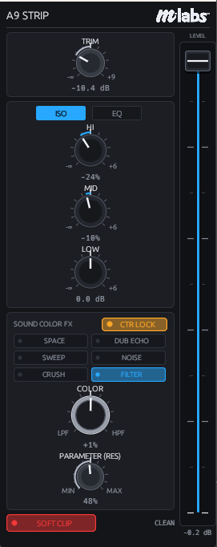

# A9 Strip

A **VST3** and **CLAP** audio plugin modeled on the **Pioneer DJ DJM-A9** mixer channel strip, built in Rust with 64-bit internal DSP (`nih-plug` + `egui`).



## Features

- **Exact DJM-A9 Channel Signal Flow:**
  `Input` → `Trim` → `3-Band EQ / Isolator` → `Sound Color FX (6 FX)` → `Channel Fader` → `Subtle Soft Clipper` → `Output`
- **64-Bit Internal Floating-Point DSP:** All EQ, crossover, and Sound Color FX processing runs in `f64` with per-sample parameter smoothing and zero audio-thread heap allocations.
- **Trim (`-∞ dB` to `+9 dB`):** Unity (`0 dB`) at 12 o'clock.
- **Switchable 3-Band `ISO` / `EQ` (`HI`, `MID`, `LOW`):**
  - **ISO Mode (`-∞ dB` full kill to `+6 dB`):** Phase-aligned 4th-order Linkwitz-Riley (24 dB/oct) 3-band crossover (`280 Hz` / `3.8 kHz`) that sums mathematically flat at `0 dB` and kills cleanly to silence at full counter-clockwise.
  - **EQ Mode (`-26 dB` to `+6 dB`):** Musical Pioneer DJM shelf/bell voicing (`70 Hz` Low Shelf, `1 kHz` Mid Bell, `13 kHz` High Shelf).
  - Click-free crossfade when toggling between `ISO` and `EQ`.
- **All 6 DJM-A9 Sound Color FX + `PARAMETER` Knob + `CTR LOCK`:**
  Clicking any FX button activates it; clicking the active button toggles Sound Color FX off. When **`CTR LOCK`** is enabled, dragging the `COLOR` knob across 12 o'clock locks dead at center until you release and drag again.

  | Effect | `COLOR` Left (CCW) | `COLOR` Right (CW) | `PARAMETER` Knob |
  | :--- | :--- | :--- | :--- |
  | **SPACE** | Mid-Low stereo club reverb | Mid-High airy stereo reverb | Feedback (tail length) |
  | **DUB ECHO** | Mid-range dub tape echo | High-range dub tape echo | Feedback (repeat decay) |
  | **SWEEP** | Widening Notch filter sweep | Narrowing Band-Pass sweep | Center Freq / Resonance |
  | **NOISE** | Low-Pass filtered white noise (dark) | High-Pass filtered white noise (bright) | Noise Volume |
  | **CRUSH** | Bit-crush & sample-rate decimation | Crushed signal + rising High-Pass Filter | Grit / Drive Intensity |
  | **FILTER** | 4-pole Low-Pass Filter (`20 kHz → 25 Hz`) | 4-pole High-Pass Filter (`20 Hz → 18 kHz`) | Resonance (Q) |

- **Vertical Channel Fader (`LEVEL`):** Pioneer P-Lock styled fader (`0.0 dB` full up down to `-∞ dB` mute) with smooth club-mixer taper.
- **Subtle Output Soft Clipper (`SOFT CLIP`):** Bit-transparent below `-1.5 dBFS`, with a smooth `C1`-continuous `tanh` headroom knee above `-1.5 dBFS` and a live `HEADROOM` / `CLIP` indicator.
- **15-Segment LED Level Meter:** Pioneer-style Green / Amber / Red peak meter.

### Controls & Shortcuts
- **Double-click** any knob or the fader to reset to default (`12 o'clock` / `0.0 dB`).
- **`Shift + Drag`** for fine adjustment.
- **Scroll wheel** over any knob or fader for quick tweaks.

## Building from Source

### Prerequisites
- [Rust toolchain](https://rustup.rs/) (stable)
- On Windows: Visual Studio Build Tools (MSVC)

### Run DSP Unit Tests
```bash
cargo test
```

### Build VST3 & CLAP Bundles
```bash
cargo xtask bundle a9_strip --release
```

The compiled plugin bundles will be created at:
- `target/bundled/A9 Strip.vst3`
- `target/bundled/A9 Strip.clap`

## Installing on Windows

Copy `target/bundled/A9 Strip.vst3` into your system VST3 folder:
```powershell
New-Item -ItemType Directory -Force "C:\Program Files\Common Files\VST3" | Out-Null
Copy-Item -Recurse -Force "target\bundled\A9 Strip.vst3" "C:\Program Files\Common Files\VST3\"
```

*(Optional)* For CLAP-compatible DAWs (Bitwig, Reaper, FL Studio, etc.), copy `target/bundled/A9 Strip.clap` to `C:\Program Files\Common Files\CLAP\`.

Rescan plugins in your DAW and load **A9 Strip**.

## License

MIT — see [LICENSE](LICENSE).
